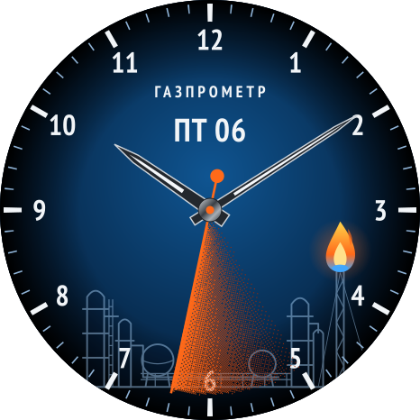
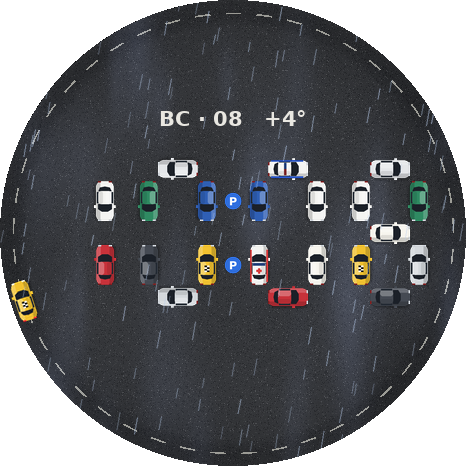

# Циферблаты для Amazfit

## Манометр — Amazfit Active 2 (Round)

Циферблат в стиле промышленного прибора: шкала с красной и жёлтой зонами, плавная секундная стрелка со шлейфом,
секундная стрелка со шлейфом, газоперерабатывающий завод с факелом на фоне.

### Установка

1. В приложении Zepp включите режим разработчика: Профиль → Настройки → О приложении → 7 раз нажмите на значок Zepp.
2. Профиль → Режим разработчика → Сканировать.
3. Отсканируйте QR-код установки.

## Парковка — Amazfit Active 2 (Round)

Электронный циферблат: каждая цифра из семи машин. Перед сменой минуты к машинам идут водители, садятся и уезжают, на свободные места заезжают другие. Секунды — такси по кольцевой. Касание двоеточия — машины съезжаются заново.

PRO (99 ₽, pay.softosale.ru/parking/): погода — дождь, снег, туман, температура; разные машины — цветные, такси, полиция и скорая.

Файл: `parking-1.1.0.zpk`.
